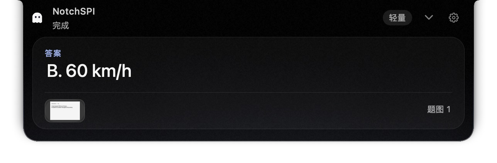
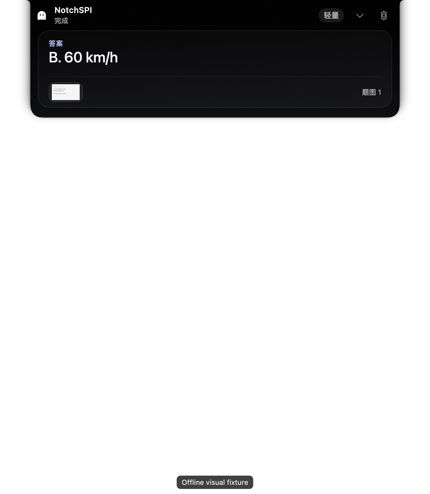
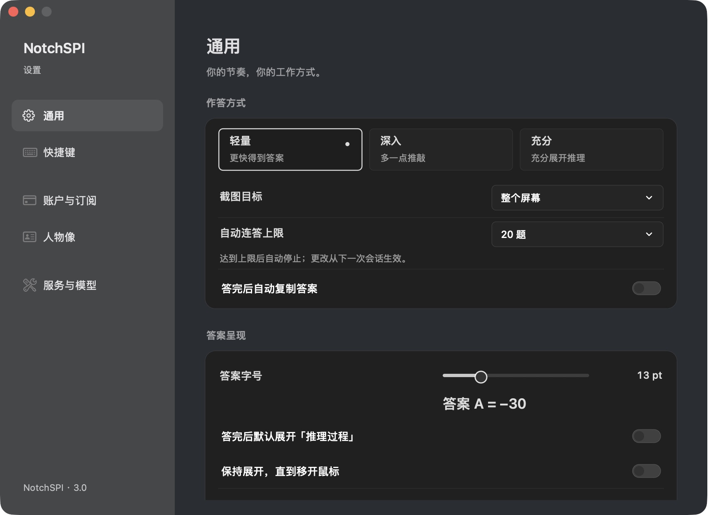
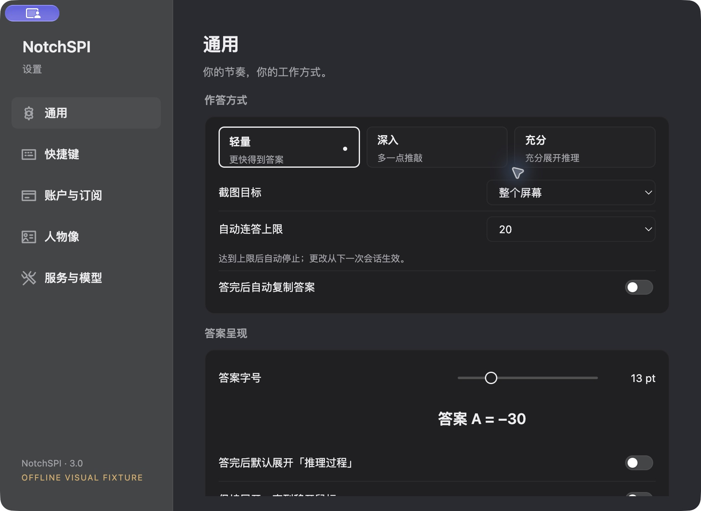

# macOS 验收基线

## 版本与证据范围

- 初始工作区干净，基线 `8b4f3f0`，`VERSION.env` 为 3.0 / 27。应用实现来源 `3c47cf9`，随后提交为发布交接材料。
- 读取 `HANDOVER.md`、`docs/client-behavior.md`、`docs/official-api.md`、`docs/history/index.json` 中的 Windows 前置基线归档，并逐项对照 AppKit 截图/流式请求/解析/结算/设置/历史实现。
- 本机为 Apple Silicon macOS 27。启动由当前源码编译的隔离 `NotchSPI Design QA.app`，实际操作答案与设置五页；不是根据网页或设计图猜测。
- QA 界面内容是明确的离线 fixture，未调用付费模型。没有 Windows 主机或 VM；所有 `desktop-macos-*` 图片均为 Windows 目标 UI 在 macOS Electron 上运行。
- 未录制 Windows 视频，未验证 Windows 的帧时间、DPI、字体栅格化或系统截图行为。

## 主要界面对照

| AppKit Mac 基线 | 桌面 UI 的 macOS 运行证据 |
|---|---|
|  |  |
|  |  |

截图原样保存；窗口大小和透明边缘不同，因此不能把图片像素宽度直接当成产品内容宽度。两者均为 600 pt/CSS px 的展开布局。Electron 底部有离线 fixture 标签。截图用于逐项审查，**不代表 Windows 实机截图**。

## 功能与状态基线

| 功能 | 现有 Mac 行为 / Windows 对齐依据 |
|---|---|
| 单次查题 | 快捷键捕获、JPEG 处理、冻结配置、请求、流式内容、FINAL/客观题组合、最终结算、可用答案后复制/历史 |
| 多图 | 最多 4 张；1 张等待；2–4 张最后一次有效变更后 4 秒提交；预览暂停，关闭重置；删除可 8 秒撤销；取消使在途捕获失效 |
| 官方链路 | 注册幂等尝试 ID、安全保存 token、客户端配置控制 objective/screen_query，最后一张题图为目标，之前为材料 |
| 流式 | 严格 delta→usage→DONE；隐藏机器协议标记及残缺前缀；完整内容和结束标记才成为成功 |
| 异常 | 401 保留恢复凭据，余额版本不可倒退；截流不能把部分答案当成功；不自动重放可能已计费的 POST |
| 结算后续 | 状态查询、服务允许时显式补取/解释；解释绑定原题及最终答案；重试重新截图，不复用已计费请求 ID |
| 计费 | 可用 ready/review 为 1 次，retake/空结果/失败为 0；补取、解释不额外扣题；体验显式领取 |
| 自动连答 | 640 格亮度差检测、稳定采样、题数上限，支持 100/无限；15 分钟空闲与连续捕获失败停止 |
| 人物像 | 按题号显示选择；机器上下文不显示；5 条/15 分钟/8 KiB 上下文边界；失败上一题设 unavailable 屏障 |
| 历史 | 100 条、30 天、200 MiB；本机保存，回看不请求，不扣题；人物像不进入普通题目历史 |
| 设置 | 通用、快捷键、账户与订阅、人物像、服务与模型；中文/日文/英文；跟随系统明暗 |
| 渠道 | 官方、自定义 OpenAI compatible/Anthropic API、本地 Codex/Claude CLI；CLI 仍受每设备 `cli_enabled` 开关约束 |

## 视觉与动效参数

来源：`NotchDesign.swift`、`NotchGeometry.swift`、`NotchView.swift`、`GhostIndicator.swift`、`ScreenshotFlight.swift`、`ScreenshotRound.swift`。

| 项目 | 基线 |
|---|---|
| 展开内容宽度 | 600；无物理刘海收起锚点 200×28；阴影预留水平 22、底部 28 |
| 内容布局 | 标题行 48，水平内缩 20，底部 16；内容卡内部 14/16；卡片随内容高度变化 |
| 外轮廓 | 顶部内凹肩角 6→8，下角 14→22；展开过冲时圆角放大响应 |
| 主色 | 顶缝纯黑，正文白 .96、次级白 .60；低强度冷色渐变、噪点、高光细边；错误暖红 |
| 设置 | 标题 22 semibold、正文 13、分区 12、元信息 11；210 侧栏；分组底面及统一行布局 |
| 展开 | 320 ms，`1-exp(-6t)*cos(5.2t)`，约 4.7% 过冲；最后精确落点 |
| 收起 | 320 ms，`1-(1-t)^2*(1+1.5t)*exp(-1.5t)`；高内容底边额外追赶；无反弹 |
| 内容透明度 | 打开 .12–.86，关闭 0–.72，双 smoothstep；反转从当前透明度与几何开始 |
| Ghost | 同一持久元素滑移，20 pt；思考 1.4 s，点阵 1.05 s；完成确认 1.25 s；减少动态效果时停止循环 |
| 截图飞入 | Mac 独立全桌面穿透面板，680 ms，对称三次曲线，30 pt 上抬，±2.2°轻旋转，动态目标与相机区域避让 |

Windows 采用与基线相同的黑曜石绘制，不依赖系统 Acrylic 去替代已有实体材质。Segoe UI / Microsoft YaHei UI 替代平台字体，仍需 Windows 实机验证字号密度和换行。Mac CG 阴影和 CSS 的坐标/模糊语义不同，桌面预览按实际截图调整了投影方向；这项需要 Windows DWM 上复核。

本轮已补齐跨屏飞入及完整 Ghost 引擎，并以 Mac 固定版本的原 Swift 引擎作为独立逐帧基准。最新截图、实际合成窗口验证及残余系统差异见 [动效与共享 UI 验收](motion-and-shared-ui.md)。
